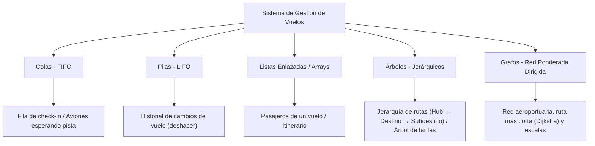
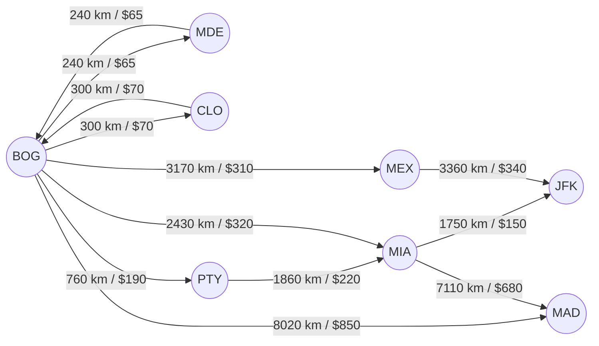

# Sistema de Gestión de Vuelos / Aeropuerto ✈️

Sistema integral para la gestión y simulación de operaciones aeroportuarias y de vuelos comerciales, implementado mediante estructuras de datos clásicas y avanzadas para optimizar cada proceso operativo.

---

## 👥 Estructura del Equipo y División de Módulos

Según la arquitectura del proyecto y la asignación por ramas de trabajo:

| Integrante | Rama Git | Estructuras de Datos | Módulo Asignado | Tablas BD (Fase BD) | Tarea Compartida |
| :--- | :--- | :--- | :--- | :--- | :--- |
| **Integrante 1** | `feature/pasajeros` | **Cola + Pila** | Pasajeros, reservas, check-in, historial con deshacer | `pasajeros`, `reservas` | Publicar el backend |
| **Integrante 2** | `feature/vuelos` | **Heap + Trie** | Vuelos, tablero, torre de control, buscador | `vuelos`, `aeropuertos` | Publicar el frontend |
| **Integrante 3** | `feature/rutas` | **Grafo** | Red de rutas, ruta más corta (Dijkstra), escalas | `rutas` *(origen, destino, distancia)* | **Documento final + README.md** |

> **Nota de desarrollo para `feature/rutas`**: Siguiendo los requerimientos actuales, el módulo opera completamente **en memoria** mediante la estructura de datos `Graph`, manteniendo total desacoplamiento de la base de datos hasta la fase de integración general.

---

## 📐 Estructuras de Datos en el Sistema

El sistema implementa de forma especializada las principales estructuras de datos de las ciencias de la computación:



1. **Colas (Queue - FIFO)**: Modelan la fila de pasajeros en los mostradores de check-in y la cola de aeronaves esperando autorización en pista de despegue/aterrizaje.
2. **Pilas (Stack - LIFO)**: Gestionan el historial de operaciones reversibles del vuelo y reservas, permitiendo revertir y deshacer (`undo`) la última modificación realizada.
3. **Listas (Lists / Arrays)**: Almacenan la lista secuencial de pasajeros asignados a un vuelo y los itinerarios con escalas intermedias.
4. **Árboles (Trees)**: Representan la jerarquía de distribución de rutas (Aeropuerto Hub principal $\rightarrow$ Destinos secundarios $\rightarrow$ Sub-destinos regionales) y árboles de decisiones para cotización dinámica de tarifas.
5. **Grafos (Graphs - Módulo `feature/rutas`)**: Modelan la red global de rutas aéreas mediante un **Grafo Ponderado y Dirigido**. Permite calcular la ruta óptima en distancia, tiempo o costo con el **Algoritmo de Dijkstra**, y descubrir conexiones y escalas mediante **recorrido DFS**.

---

## 🌐 Módulo de Rutas: Grafo y Algoritmo de Dijkstra (`feature/rutas`)

### 1. Representación del Grafo
El módulo implementa un grafo dirigido ponderado mediante **listas de adyacencia optimizadas (`Map`)**:
- **Vértices ($V$)**: Aeropuertos identificados por su código IATA (ej: `BOG`, `MDE`, `CLO`, `PTY`, `MIA`, `JFK`, `MAD`, `MEX`), con atributos de nombre, ciudad y país.
- **Aristas ($E$)**: Conexiones de vuelo con pesos multidimensionales:
  - `distancia`: Distancia en kilómetros (km).
  - `precio`: Tarifa promedio del trayecto en USD ($).
  - `duracion`: Tiempo estimado de vuelo en minutos.
  - `aerolinea`: Línea aérea que opera la conexión.
  - `vuelo`: Código de vuelo asignado.



### 2. Algoritmo de Dijkstra
Calcula la ruta más eficiente entre dos nodos según una función de costo seleccionable:
- $\text{Criterio Distancia}$: Minimiza los kilómetros recorridos.
- $\text{Criterio Precio}$: Minimiza el gasto acumulado del boleto.
- $\text{Criterio Duración}$: Minimiza el tiempo en el aire.

**Complejidad algorítmica**:
- Tiempo: $\mathcal{O}(|V|^2)$ con conjunto no visitado, optimizable a $\mathcal{O}((|V| + |E|) \log |V|)$ con Min-Heap.
- Espacio: $\mathcal{O}(|V| + |E|)$ en lista de adyacencia.

### 3. Búsqueda de Rutas con Escalas (`findAllRoutes`)
Algoritmo basado en Depth-First Search (DFS) con backtracking y poda por profundidad máxima (`maxStops`), que retorna:
- Todas las rutas posibles (vuelos directos, 1 escala, 2 escalas).
- Desglose tramo por tramo, kilometraje total y precio acumulado.

---

## 🚀 Instalación y Ejecución

### Prerrequisitos
- Node.js (versión 18 o superior)
- npm

### Pasos

1. Clonar el repositorio y ubicarse en la rama `feature/rutas`:
```bash
git clone https://github.com/leidytathernandez/sistema_de_gestion_de_vuelos.git
cd sistema_de_gestion_de_vuelos
git checkout feature/rutas
```

2. Instalar dependencias del backend:
```bash
cd backend
npm install
```

3. Ejecutar las pruebas unitarias e integración (Node Test Runner):
```bash
npm test
```

4. Iniciar el servidor en modo desarrollo:
```bash
npm run dev
```
El backend iniciará en `http://localhost:3000`.

---

## 📡 Documentación de la API REST (`/api/rutas`)

### 1. Estado del Servidor
- **URL**: `GET /api/health`
- **Respuesta**:
```json
{
  "status": "ok",
  "message": "API del sistema de vuelos funcionando"
}
```

---

### 2. Obtener Topología Completa de la Red
- **URL**: `GET /api/rutas`
- **Respuesta**:
```json
{
  "totalVertices": 10,
  "totalAristas": 26,
  "vertices": [
    { "id": "BOG", "nombre": "Aeropuerto Internacional El Dorado", "ciudad": "Bogotá", "pais": "Colombia" }
  ],
  "aristas": [
    {
      "origen": "BOG",
      "destino": "MIA",
      "distancia": 2430,
      "precio": 320,
      "duracion": 240,
      "aerolinea": "Avianca",
      "vuelo": "AV008"
    }
  ]
}
```

---

### 3. Calcular Ruta Óptima con Dijkstra
Encuentra el camino más corto o más económico entre dos aeropuertos.

- **URL**: `GET /api/rutas/corta?origen=BOG&destino=JFK&criterio=distancia`
- **Parámetros Query**:
  - `origen` *(requerido)*: Código IATA de partida (ej: `BOG`).
  - `destino` *(requerido)*: Código IATA de llegada (ej: `JFK`).
  - `criterio` *(opcional)*: `distancia` | `precio` | `duracion` (por defecto `distancia`).
- **Respuesta**:
```json
{
  "encontrado": true,
  "origen": "BOG",
  "destino": "JFK",
  "criterio": "distancia",
  "pesoTotal": 4180,
  "resumen": {
    "totalDistanciaKm": 4180,
    "totalPrecioUSD": 470,
    "totalDuracionMin": 425,
    "horasAproximadas": "7.1"
  },
  "escalas": 1,
  "aeropuertosEscala": ["MIA"],
  "camino": ["BOG", "MIA", "JFK"],
  "tramos": [
    {
      "desde": "BOG",
      "hacia": "MIA",
      "distancia": 2430,
      "precio": 320,
      "duracion": 240,
      "aerolinea": "Avianca",
      "vuelo": "AV008"
    },
    {
      "desde": "MIA",
      "hacia": "JFK",
      "distancia": 1750,
      "precio": 150,
      "duracion": 185,
      "aerolinea": "American Airlines",
      "vuelo": "AA1240"
    }
  ]
}
```

---

### 4. Buscar Alternativas de Vuelo con Escalas
- **URL**: `GET /api/rutas/escalas?origen=BOG&destino=MAD&maxEscalas=2`
- **Parámetros Query**:
  - `origen` *(requerido)*: Código IATA de origen.
  - `destino` *(requerido)*: Código IATA de destino.
  - `maxEscalas` *(opcional)*: Número máximo de paradas intermedias (por defecto 2).
- **Respuesta**:
```json
{
  "origen": "BOG",
  "destino": "MAD",
  "maxEscalasPermitidas": 2,
  "totalRutasEncontradas": 2,
  "rutas": [
    {
      "camino": ["BOG", "MAD"],
      "escalas": 0,
      "aeropuertosEscala": [],
      "totalDistanciaKm": 8020,
      "totalPrecioUSD": 850,
      "totalDuracionMin": 590
    },
    {
      "camino": ["BOG", "MIA", "MAD"],
      "escalas": 1,
      "aeropuertosEscala": ["MIA"],
      "totalDistanciaKm": 9540,
      "totalPrecioUSD": 1000,
      "totalDuracionMin": 750
    }
  ]
}
```

---

### 5. Registrar un Nuevo Aeropuerto
- **URL**: `POST /api/rutas/aeropuertos`
- **Body JSON**:
```json
{
  "codigo": "CLO",
  "nombre": "Aeropuerto Internacional Alfonso Bonilla Aragón",
  "ciudad": "Cali",
  "pais": "Colombia"
}
```

---

### 6. Registrar una Nueva Conexión de Ruta
- **URL**: `POST /api/rutas`
- **Body JSON**:
```json
{
  "origen": "MDE",
  "destino": "MIA",
  "distancia": 2250,
  "precio": 280,
  "duracion": 215,
  "aerolinea": "Avianca",
  "bidireccional": true
}
```

---

### 7. Estadísticas de Conectividad de la Red
- **URL**: `GET /api/rutas/estadisticas`
- **Respuesta**:
```json
{
  "totalAeropuertos": 10,
  "totalRutasDirectas": 26,
  "aeropuertoMasConectado": {
    "id": "BOG",
    "nombre": "Aeropuerto Internacional El Dorado",
    "ciudad": "Bogotá",
    "pais": "Colombia",
    "rutasSalientes": 7,
    "rutasEntrantes": 7
  }
}
```

---

## 🧪 Pruebas Automatizadas

El proyecto utiliza el test runner nativo de Node.js (`node --test`), eliminando dependencias externas pesadas para las pruebas:

```bash
npm test
```

Se ejecutan suites completas que validan:
- Inserción y validación de vértices y aristas del grafo.
- Comportamiento de Dijkstra en caminos directos y compuestos.
- Detección de caminos inalcanzables.
- Exploración de rutas con escalas (DFS).
- Integración de endpoints HTTP Express con respuestas 200, 201 y 404.

---

## 📄 Documento Final
La especificación técnica ampliada, fundamentos teóricos y análisis de complejidad de las estructuras de datos se encuentra detallada en [`docs/DOCUMENTO_FINAL.md`](docs/DOCUMENTO_FINAL.md).