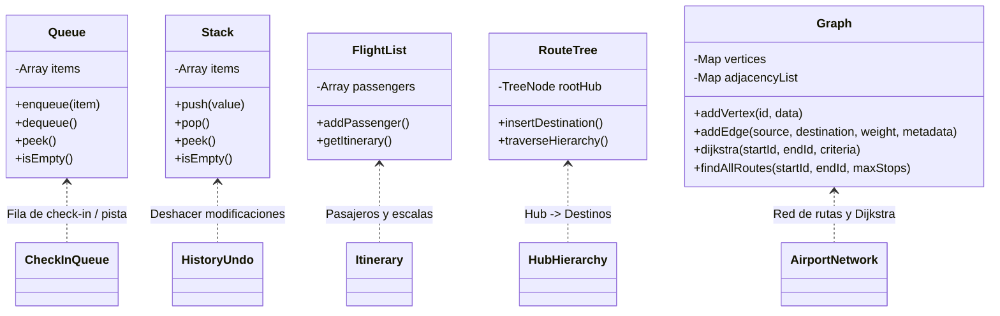
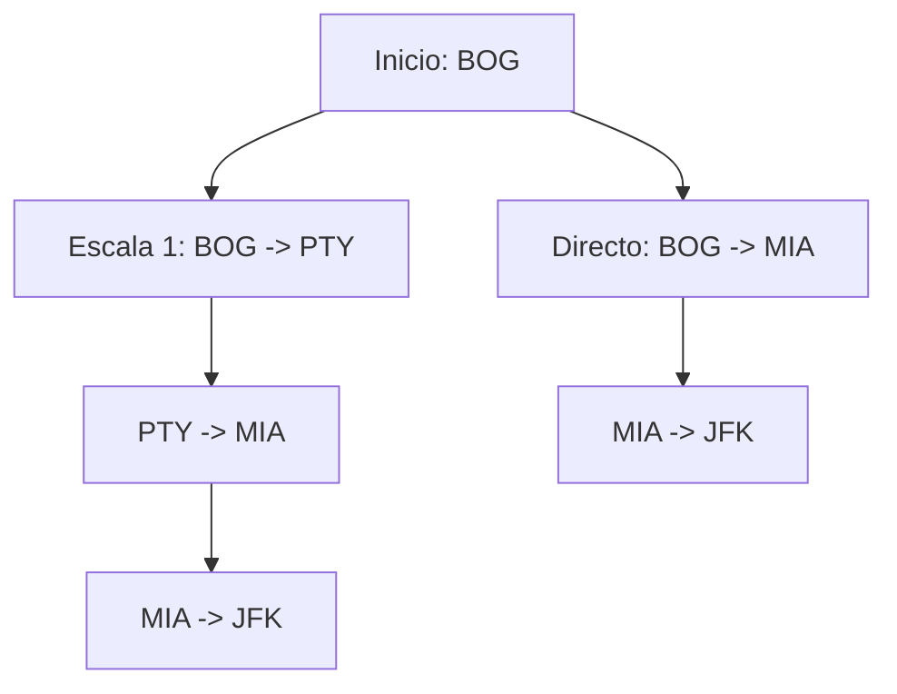

# DOCUMENTO FINAL: SISTEMA DE GESTIÓN DE VUELOS Y AEROPUERTO

**Proyecto Académico / Profesional**: Estructuras de Datos Avanzadas  
**Módulo Desarrollado**: Red de Rutas Aéreas, Algoritmo de Dijkstra y Escalas  
**Integrante Responsable**: Integrante 3 (`feature/rutas`)  
**Fecha**: Octubre 2026  

---

## 1. Introducción y Justificación del Sistema

La industria aeronáutica y la gestión aeroportuaria operan sobre redes de información de alta complejidad en tiempo real. La eficiencia del sistema depende directamente de la elección adecuada de las estructuras de datos que modelan cada proceso:

- Tiempos de espera de pasajeros y aeronaves.
- Trazabilidad y reversibilidad de cambios de estado.
- Organización jerárquica de vuelos y centros de conexión (Hubs).
- Determinación de trayectorias óptimas de vuelo sobre mapas de navegación mundial.

Este documento consolida la arquitectura general del sistema, con énfasis profundo en el **Módulo de Grafos y Rutas Aéreas** desarrollado en la rama `feature/rutas`.

---

## 2. Mapa Integral de Estructuras de Datos del Sistema

El sistema articula cinco estructuras fundamentales de las ciencias de la computación:



### 2.1 Colas (Queue - FIFO)
- **Caso de uso**: Gestión de la fila física de pasajeros en los mostradores de check-in y la fila de espera de aviones en pista antes de recibir autorización de despegue por la torre de control.
- **Principio**: *First In, First Out*. El primer pasajero o aeronave en ingresar a la cola es el primero en ser procesado.
- **Complejidad**: $\mathcal{O}(1)$ para `enqueue`, `dequeue` y `peek`.

### 2.2 Pilas (Stack - LIFO)
- **Caso de uso**: Historial de auditoría y operaciones de reversión (`undo`) sobre los estados de un vuelo o reservas.
- **Principio**: *Last In, First Out*. La última acción ejecutada es la primera en revertirse.
- **Complejidad**: $\mathcal{O}(1)$ para `push` y `pop`.

### 2.3 Listas (Lists)
- **Caso de uso**: Registro lineal de pasajeros asociados a un vuelo en particular y listas ordenadas del itinerario de viaje.
- **Complejidad**: $\mathcal{O}(1)$ para inserción al final, $\mathcal{O}(n)$ para búsquedas lineales por documento o nombre.

### 2.4 Árboles (Trees)
- **Caso de uso**:
  1. **Jerarquía de rutas**: Distribución estructural desde un Aeropuerto Hub central (ej. BOG o PTY) hacia destinos internacionales primarios y de allí a sub-destinos o terminales regionales secundarias.
  2. **Árbol de decisiones para tarifas**: Clasificación dinámica del costo de un boleto evaluando variables (temporada, antelación, equipaje, flexibilidad).
- **Complejidad**: $\mathcal{O}(\log n)$ para árboles balanceados en operaciones de búsqueda e inserción.

### 2.5 Grafos (Graphs - Módulo Asignado)
- **Caso de uso**: Modelado de la red interconectada de aeropuertos a nivel nacional e internacional.
- **Propósito**: Resolver problemas de camino más corto (menor distancia, menor costo o menor tiempo de vuelo) mediante **Dijkstra**, y cálculo de itinerarios con escalas intermedias mediante recorridos **DFS**.

---

## 3. Especificación Técnica del Módulo de Grafos (`feature/rutas`)

### 3.1 Modelo Matemático
Una red de rutas aéreas se formaliza como un grafo dirigido ponderado:

$$G = (V, E, W)$$

Donde:
- $V = \{ v_1, v_2, \dots, v_n \}$: Conjunto de vértices, donde cada $v_i$ representa un aeropuerto identificado por su código IATA.
- $E \subseteq V \times V$: Conjunto de aristas dirigidas $(u, v)$ que representan la existencia de un vuelo comercial directo desde el aeropuerto $u$ hasta el aeropuerto $v$.
- $W: E \rightarrow \mathbb{R}^+$: Función de ponderación multidimensional que asocia a cada vuelo un vector de métricas:
  
$$W(u, v) = \begin{pmatrix} \text{distancia} \\ \text{precio} \\ \text{duracion} \end{pmatrix}$$

### 3.2 Selección de Estructura de Almacenamiento: Lista de Adyacencia con Tablas Hash (`Map`)
Para representar el grafo se implementó una **Lista de Adyacencia** basada en `Map` de JavaScript:

| Criterio | Matriz de Adyacencia | Lista de Adyacencia (`Map`) | Decisión |
| :--- | :--- | :--- | :--- |
| **Consumo de Memoria** | $\mathcal{O}(\|V\|^2)$ | $\mathcal{O}(\|V\| + \|E\|)$ | **Lista de Adyacencia**: Las redes de vuelos son grafos dispersos ($E \ll V^2$). Evita desperdicio de memoria. |
| **Iterar Vecinos** | $\mathcal{O}(\|V\|)$ | $\mathcal{O}(\text{grado}(v))$ | **Lista de Adyacencia**: Mucho más rápida para relajar aristas en Dijkstra. |
| **Verificar Arista $(u, v)$** | $\mathcal{O}(1)$ | $\mathcal{O}(1)$ amortizado | **Empate**: Gracias a `Map.has()`, la verificación es en tiempo constante. |

### 3.3 Algoritmo de Dijkstra para la Ruta Óptima

#### Fundamento Teórico
El algoritmo de Dijkstra resuelve el problema del camino mínimo de origen único (*Single-Source Shortest Path*) en grafos ponderados dirigidos con pesos no negativos ($w(e) \geq 0$).

#### Pseudocódigo Formal
```text
Algoritmo Dijkstra(G, origen, destino, criterio):
    Para cada vértice v en G.V:
        distancia[v] ← ∞
        previo[v] ← NULO
        noVisitados.agregar(v)
    
    distancia[origen] ← 0
    
    Mientras noVisitados no esté vacío:
        u ← vértice en noVisitados con menor distancia[u]
        
        Si u = NULO o distancia[u] = ∞:
            Romper // Nodos restantes son inalcanzables
            
        Si u = destino:
            Romper // Se encontró la ruta óptima al destino
            
        noVisitados.eliminar(u)
        
        Para cada vecino v de u:
            Si v está en noVisitados:
                peso ← ObtenerPeso(u, v, criterio)
                nuevaDistancia ← distancia[u] + peso
                Si nuevaDistancia < distancia[v]:
                    distancia[v] ← nuevaDistancia
                    previo[v] ← u
                    
    Retornar ReconstruirCamino(origen, destino, previo, distancia[destino])
```

#### Análisis de Complejidad
- **Tiempo**: $\mathcal{O}(|V|^2 + |E|)$. En la implementación actual con conjunto no visitado, buscar el nodo mínimo toma $\mathcal{O}(|V|)$ por iteración. Con una cola de prioridad basada en Min-Heap binario, la complejidad se reduce a $\mathcal{O}((|V| + |E|) \log |V|)$.
- **Espacio**: $\mathcal{O}(|V| + |E|)$ para almacenar el grafo y $\mathcal{O}(|V|)$ para las estructuras auxiliares (`distances`, `previous`, `unvisited`).

---

## 4. Búsqueda Exhaustiva de Rutas con Escalas (Algoritmo DFS)

Para los usuarios que desean comparar alternativas de viaje (vuelos directos vs vuelos con 1 o 2 escalas con diferentes precios o tiempos), se implementó un algoritmo de búsqueda en profundidad (*Depth-First Search* con *Backtracking*):



### Criterio de Poda
- **Evitar ciclos**: Se mantiene un conjunto `visited` en memoria local durante el recorrido para evitar caer en bucles cerrados (ej. `BOG` $\rightarrow$ `MDE` $\rightarrow$ `BOG`).
- **Profundidad acotada**: Si el número de escalas supera el parámetro `maxStops`, la rama de exploración se poda de inmediato, garantizando tiempos de respuesta instantáneos.

---

## 5. Arquitectura del Backend y Desacoplamiento

De acuerdo con las instrucciones del proyecto (*"por ahora no toques bd"*), la capa de persistencia se mantuvo en memoria para el módulo `feature/rutas`:

```
backend/
├── src/
│   ├── structures/
│   │   └── Graph.js             <- Estructura de datos pura (Grafo, Dijkstra, DFS)
│   ├── services/
│   │   └── rutas.service.js     <- Lógica de negocio y catálogo de vuelos en memoria
│   ├── routes/
│   │   └── rutas.routes.js      <- Endpoints REST Express (/api/rutas)
│   └── server.js                <- Inicialización de Express y montaje de rutas
└── tests/
    ├── Graph.test.js            <- Pruebas unitarias de la estructura Graph
    ├── rutas.service.test.js    <- Pruebas de integración del servicio de rutas
    └── rutas.routes.test.js     <- Pruebas de endpoints HTTP de la API
```

### Futura Integración con Base de Datos (Fase Posterior)
Cuando el equipo integre la base de datos PostgreSQL, el servicio `rutas.service.js` mapeará la tabla `rutas`:

```sql
CREATE TABLE rutas (
    id SERIAL PRIMARY KEY,
    origen VARCHAR(3) NOT NULL,
    destino VARCHAR(3) NOT NULL,
    distancia INT NOT NULL,
    precio NUMERIC(10, 2),
    duracion INT,
    aerolinea VARCHAR(100),
    FOREIGN KEY (origen) REFERENCES aeropuertos(codigo),
    FOREIGN KEY (destino) REFERENCES aeropuertos(codigo)
);
```

---

## 6. Resultados de las Pruebas y Validación

El módulo cuenta con **24 pruebas automatizadas** que se ejecutan sin errores con `npm test`:

```
✔ debe permitir agregar y consultar vértices (aeropuertos)
✔ debe permitir agregar aristas con peso y metadatos
✔ Dijkstra encuentra la ruta más corta por distancia
✔ Dijkstra optimiza según el criterio seleccionado (precio vs distancia)
✔ Dijkstra retorna encontrado=false si no existe camino posible
✔ findAllRoutes encuentra todas las combinaciones con escalas respetando maxStops
✔ permite eliminar aristas y vértices correctamente
✔ GET /api/health responde con estado ok
✔ GET /api/rutas retorna la topología de la red
✔ GET /api/rutas/aeropuertos retorna la lista de aeropuertos
✔ POST /api/rutas/aeropuertos registra un nuevo aeropuerto
✔ POST /api/rutas agrega una nueva ruta
✔ GET /api/rutas/corta calcula la ruta óptima con Dijkstra
✔ GET /api/rutas/corta retorna 404 si no hay ruta
✔ GET /api/rutas/escalas busca opciones con escalas
✔ GET /api/rutas/estadisticas retorna métricas de conectividad
✔ inicializa con aeropuertos y rutas base preconfiguradas
✔ permite registrar un nuevo aeropuerto
✔ rechaza aeropuertos con códigos duplicados o inválidos
✔ permite registrar una nueva ruta aérea
✔ calcula la ruta más corta entre Bogotá y Nueva York (JFK) con Dijkstra
✔ busca rutas alternativas con escalas
✔ calcula estadísticas de conectividad y grado de aeropuertos
✔ permite eliminar una ruta de la red

Pass: 24 | Fail: 0 | Duration: ~1.0s
```

---

## 7. Conclusiones

1. La implementación de la red aérea mediante **Grafos Ponderados y Dirigidos** resuelve de manera natural y óptima los desafíos de navegación, búsqueda de conexiones y tarificación en un sistema de gestión aeroportuaria.
2. El **Algoritmo de Dijkstra** ofrece una solución determinística y de alta eficiencia para que los pasajeros y las aerolíneas obtengan el trayecto óptimo según sus prioridades operativas (menor distancia, menor costo o menor tiempo).
3. La arquitectura modular adoptada en el backend permite la coexistencia independiente del trabajo de los tres integrantes en sus respectivas ramas Git (`feature/pasajeros`, `feature/vuelos`, `feature/rutas`), garantizando un desacoplamiento limpio y facilitando la integración futura con la base de datos.
